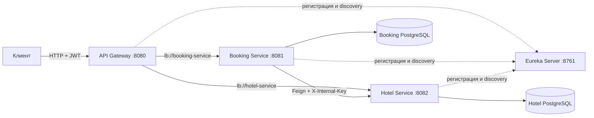

# Hotel Booking Platform

Учебная распределённая REST API-система бронирования отелей. Проект реализован как
Maven-мультимодуль на Java 17, Spring Boot 3.5.15 и Spring Cloud 2025.0.3.

## Что реализовано

- Eureka Server (`8761`) — реестр сервисов;
- API Gateway (`8080`) — маршрутизация, проверка JWT и `X-Request-Id`;
- Booking Service (`8081`) — регистрация/вход, JWT, свои брони, пагинация,
  идемпотентность и оркестрация саги;
- Hotel Service (`8082`) — CRUD отелей/номеров, фильтры, статистика, рекомендации,
  транзакционная доступность и компенсация;
- H2 для локальной разработки/тестов и две независимые PostgreSQL 17 в Docker;
- Flyway-миграции, persistent volumes, liveness/readiness health checks;
- Resilience4j retry/circuit breaker и Feign timeout;
- MapStruct, Bean Validation, единый JSON ошибок, Swagger/OpenAPI;
- 34 автоматических теста: unit, MockMvc/security и интеграционные H2/JPA.

Архитектурные схемы и sequence diagram: [docs/architecture.md](docs/architecture.md).
Решения и компромиссы: [docs/adr](docs/adr). Схема данных: [docs/database.md](docs/database.md).
Развёртывание на VM: [docs/deployment.md](docs/deployment.md).

## Технологический стек

| Компонент | Технология | Назначение |
|---|---|---|
| Язык | Java 17 | реализация сервисов |
| Сборка | Maven 3.9+ | мультимодульная сборка и тесты |
| Приложение | Spring Boot 3.5.15 | REST API, конфигурация, Actuator |
| Микросервисы | Spring Cloud 2025.0.3 | Gateway, Eureka, OpenFeign, LoadBalancer |
| Основная БД | PostgreSQL 17 | долговременное хранение в Docker/VM |
| Тестовая БД | H2 | локальная разработка и интеграционные тесты |
| Миграции | Flyway | версионирование схем PostgreSQL |
| ORM | Spring Data JPA / Hibernate | доступ к данным и транзакции |
| Безопасность | Spring Security, JWT HS256, BCrypt | аутентификация и роли |
| Отказоустойчивость | Resilience4j | retry и circuit breaker |
| API-документация | SpringDoc OpenAPI / Swagger UI | описание и проверка endpoint'ов |
| Маппинг | MapStruct | преобразование entity и DTO |
| Тестирование | JUnit 5, Mockito, MockMvc, AssertJ | unit, web и integration tests |
| Контейнеризация | Docker, Docker Compose | Linux-стенд и изолированные тесты |

## Архитектура системы



### Ответственность компонентов

| Компонент | Ответственность | Публичный доступ |
|---|---|---|
| API Gateway | единая точка входа, JWT, маршрутизация, `X-Request-Id` | да, `8080` |
| Eureka Server | регистрация и обнаружение экземпляров | только dev/internal |
| Booking Service | пользователи, бронирования, история, Saga | через Gateway |
| Hotel Service | каталог, номера, доступность, статистика | через Gateway |
| Booking PostgreSQL | пользователи и состояния бронирований | нет |
| Hotel PostgreSQL | отели, номера и занятые интервалы | нет |

Каждый бизнес-сервис владеет собственной БД. Прямые SQL-запросы между сервисами
запрещены. Booking Service оркестрирует Saga: создаёт `PENDING`, запрашивает
подтверждение Hotel Service и переводит бронь в `CONFIRMED`; при ошибке выполняет
идемпотентный `release` и устанавливает `CANCELLED`.

В Hotel Service проверка пересечения дат и создание резерва выполняются в одной
транзакции с `PESSIMISTIC_WRITE`. `Idempotency-Key`/`requestId` защищает операции от
повторного выполнения. Подробная схема и sequence diagram находятся в
[docs/architecture.md](docs/architecture.md).

## Структура проекта

```text
hotel-booking/
├── api-gateway/                    # внешняя точка входа
│   ├── src/main/java/.../gateway/  # маршрутизация, JWT, trace filter
│   ├── src/main/resources/         # Gateway routes и Actuator
│   ├── src/test/                   # тест correlation ID
│   └── Dockerfile                  # multi-stage Linux image
├── eureka-server/                  # service discovery
│   ├── src/main/                   # Eureka application и настройки
│   ├── src/test/                   # context test
│   └── Dockerfile
├── booking-service/                # пользователи и процесс бронирования
│   ├── src/main/java/.../booking/
│   │   ├── client/                 # Feign-клиент Hotel Service
│   │   ├── config/                 # security, seed data, tracing
│   │   ├── controller/             # auth и booking REST API
│   │   ├── dto/                    # входные и выходные контракты
│   │   ├── entity/                 # UserAccount, Booking, статусы
│   │   ├── exception/              # единая обработка ошибок
│   │   ├── mapper/                 # MapStruct
│   │   ├── repository/             # Spring Data JPA
│   │   ├── security/               # выпуск JWT
│   │   └── service/                # аутентификация и Saga
│   ├── src/main/resources/
│   │   ├── application.yml         # H2/local профиль
│   │   ├── application-docker.yml  # PostgreSQL/docker профиль
│   │   └── db/migration/           # Flyway schema
│   ├── src/test/                   # unit, security и MockMvc tests
│   └── Dockerfile
├── hotel-service/                  # каталог и доступность номеров
│   ├── src/main/java/.../hotel/
│   │   ├── config/                 # JWT, internal key, seed data
│   │   ├── controller/             # hotels, rooms, internal API
│   │   ├── dto/                    # API-контракты
│   │   ├── entity/                 # Hotel, Room, RoomReservation
│   │   ├── mapper/                 # MapStruct
│   │   ├── repository/             # запросы, overlap и lock
│   │   └── service/                # каталог и транзакционная доступность
│   ├── src/main/resources/         # profiles и Flyway migrations
│   ├── src/test/                   # H2/JPA integration tests
│   └── Dockerfile
├── scripts/
│   ├── docker-start.sh             # сборка и запуск Linux-стенда
│   ├── docker-stop.sh              # остановка без удаления БД
│   ├── docker-restart.sh           # пересоздание контейнеров
│   ├── docker-logs.sh              # просмотр логов
│   ├── container-test.sh           # Maven + E2E тесты в Docker
│   └── smoke-test.sh               # сквозная проверка REST API
├── docs/
│   ├── architecture.md             # схемы компонентов и Saga
│   ├── database.md                 # модель данных
│   ├── deployment.md               # развёртывание на Linux VM
│   ├── testing.md                  # тестовые сценарии
│   └── adr/                        # принятые архитектурные решения
├── docker-compose.yml              # закрытый production-подобный контур
├── docker-compose.dev.yml          # публикация диагностических портов
├── docker-compose.test.yml         # контейнерные тестовые сервисы
├── Dockerfile.test                 # образ с JDK/Maven и всеми тестами
├── Makefile                        # единые команды управления
├── .env.example                    # шаблон переменных окружения
├── pom.xml                         # родительский Maven-модуль
└── README.md
```

## Потоки взаимодействия

1. Клиент получает JWT через `/api/auth/token`.
2. Все внешние запросы поступают в API Gateway.
3. Gateway проверяет JWT и выбирает сервис через Eureka/LoadBalancer.
4. Booking Service хранит состояние процесса в собственной БД.
5. Hotel Service единолично управляет доступностью номера.
6. Временные ошибки обрабатываются timeout/retry/circuit breaker.
7. `X-Request-Id` связывает логи Gateway и обоих сервисов.

## Требования

- JDK 17+;
- Maven 3.9+;
- Docker/Compose — только для контейнерного варианта.

## Архитектурные профили

| Профиль | Хранилище | Управление схемой | Назначение |
|---|---|---|---|
| default | H2 in-memory | Hibernate | быстрый локальный запуск |
| test | изолированная H2 | Hibernate | автоматические тесты |
| docker | PostgreSQL на сервис | Flyway + validate | Docker/VM |

В контейнерной схеме наружу по умолчанию открыт только API Gateway. Booking Service
и Hotel Service владеют разными БД и не обращаются к таблицам друг друга.

## Запуск тестов

Из корневой папки проекта выполните полный набор тестов всех сервисов:

```bash
mvn test
```

Успешный прогон завершается сообщением `BUILD SUCCESS`. В проекте выполняются
34 unit-, MockMvc/security- и интеграционных H2/JPA-теста.

Запуск тестов отдельного сервиса вместе с необходимыми зависимыми модулями:

```bash
mvn -pl booking-service -am test
mvn -pl hotel-service -am test
mvn -pl api-gateway -am test
mvn -pl eureka-server -am test
```

Запуск одного тестового класса:

```bash
mvn -pl booking-service -Dtest=BookingServiceImplTest test
mvn -pl hotel-service -Dtest=RoomAvailabilityIntegrationTest test
```

Подробное описание проверяемых сценариев находится в
[docs/testing.md](docs/testing.md).

### Тесты полностью внутри Docker

На Linux-хосте не нужны JDK и Maven — только Docker Compose:

```bash
chmod +x scripts/*.sh
./scripts/container-test.sh unit
```

Полный прогон: Maven-тесты, запуск PostgreSQL и микросервисов, затем API smoke-тест
из отдельного curl-контейнера:

```bash
./scripts/container-test.sh all
# эквивалентно: make test-e2e
```

Режим `smoke` проверяет JWT, рекомендации, идемпотентное бронирование и историю.

## Сборка

После успешного выполнения тестов соберите все модули:

```bash
mvn package
```

Исполняемые JAR имеют суффикс `-exec.jar`. Обычные JAR оставлены отдельно, чтобы
упаковка была надёжной и воспроизводимой на Windows.

## Запуск на Linux в Docker

```bash
cp .env.example .env
# Укажите собственные секреты и пароли БД.
chmod +x scripts/*.sh
./scripts/docker-start.sh
```

```bash
make status
make logs
make smoke
make down
```

`down` не удаляет PostgreSQL volumes.

## Локальный запуск без Docker

Локально на Windows:

```powershell
./start-all.ps1
```

Linux/macOS:

```bash
chmod +x start-all.sh
./start-all.sh
```

Контейнеры собираются multi-stage Dockerfile, поэтому предварительный `mvn package`
не нужен. Базовый `docker compose up -d --build` публикует только Gateway; скрипт
запуска подключает dev-overlay с диагностическими портами.

Порядок ручного запуска: Eureka → Hotel → Booking → Gateway. После старта доступны:

- Gateway: `http://localhost:8080`;
- Eureka: `http://localhost:8761`;
- Swagger Booking: `http://localhost:8081/swagger-ui/index.html`;
- Swagger Hotel: `http://localhost:8082/swagger-ui/index.html`.

Демонстрационные учётные записи: `user/user` (USER), `admin/admin` (ADMIN).
Секреты `JWT_SECRET` и `INTERNAL_API_KEY` необходимо переопределять вне локальной среды.

## Быстрая проверка API

Получить токен:

```bash
curl -s http://localhost:8080/api/auth/token \
  -H 'Content-Type: application/json' \
  -d '{"username":"user","password":"user"}'
```

Рекомендации на даты (токен подставить вместо `$TOKEN`):

```bash
curl 'http://localhost:8080/api/rooms/recommend?startDate=2099-01-10&endDate=2099-01-12' \
  -H "Authorization: Bearer $TOKEN"
```

Автоматический выбор и идемпотентное бронирование:

```bash
curl -i http://localhost:8080/api/bookings \
  -H "Authorization: Bearer $TOKEN" \
  -H 'Content-Type: application/json' \
  -H 'Idempotency-Key: demo-001' \
  -d '{"autoSelect":true,"startDate":"2099-01-10","endDate":"2099-01-12"}'
```

Повтор той же команды возвращает исходную бронь и не увеличивает `timesBooked`.

```bash
curl 'http://localhost:8080/api/bookings?page=0&size=20&sort=createdAt,desc' \
  -H "Authorization: Bearer $TOKEN"
```

## Публичные маршруты Gateway

| Метод | Путь | Доступ | Назначение |
|---|---|---|---|
| POST | `/api/auth/register` | public | регистрация USER и JWT |
| POST | `/api/auth/token` | public | аутентификация |
| POST | `/api/bookings` | USER/ADMIN | создание брони |
| GET | `/api/bookings` | USER/ADMIN | пагинированная история только текущего пользователя |
| GET | `/api/bookings/{id}` | USER/ADMIN | своя бронь |
| DELETE | `/api/bookings/{id}` | USER/ADMIN | отмена с release |
| GET | `/api/hotels`, `/api/hotels/{id}` | authenticated | каталог |
| GET | `/api/hotels/{id}/stats` | authenticated | загрузка и статистика |
| POST/PUT/DELETE | `/api/hotels/**` | ADMIN | управление отелями |
| GET | `/api/rooms` | authenticated | фильтры `hotelId`, `available`, `minTimesBooked` |
| GET | `/api/rooms/recommend` | authenticated | свободные номера по датам |
| POST/PUT/DELETE | `/api/rooms/**` | ADMIN | управление номерами |

`/internal/rooms/{id}/confirm-availability` и `/release` отсутствуют в маршрутах
Gateway и требуют `X-Internal-Key` при прямом межсервисном вызове.

## Согласованность и конкуренция

1. Booking Service сохраняет `PENDING` до удалённого вызова.
2. Hotel Service блокирует строку Room (`PESSIMISTIC_WRITE`), проверяет интервал
   `existing.start < requested.end && existing.end > requested.start`, сохраняет слот и
   увеличивает `timesBooked` в одной транзакции.
3. Успех переводит бронь в `CONFIRMED`.
4. Конфликт, таймаут или недоступность вызывают идемпотентный `release`, после чего
   бронь становится `CANCELLED`.

`requestId`/`Idempotency-Key` имеет уникальное ограничение в обеих БД. Рекомендации
сортируются по `timesBooked ASC, id ASC`.

## Ошибки и наблюдаемость

Ошибки имеют поля `timestamp`, `status`, `error`, `message`, `path`, `traceId` и
`validationErrors`. Gateway создаёт или сохраняет `X-Request-Id`; сервисы помещают его
в MDC. Переходы саги логируются с `bookingId`.

## Production hardening

Контейнерный профиль уже использует PostgreSQL и Flyway. Для production замените
HS256 на внешний OIDC issuer/RS256, внутренний ключ на mTLS/service identity, добавьте
persistent outbox и worker повторной компенсации, TLS, backup и централизованные логи.
