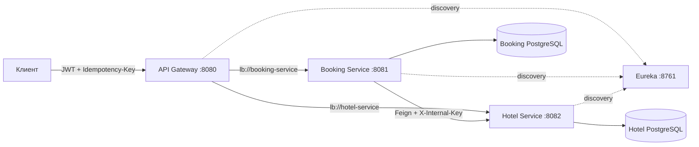
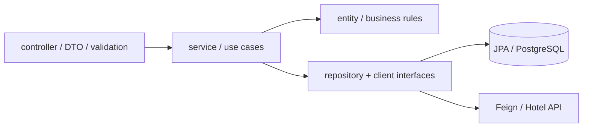
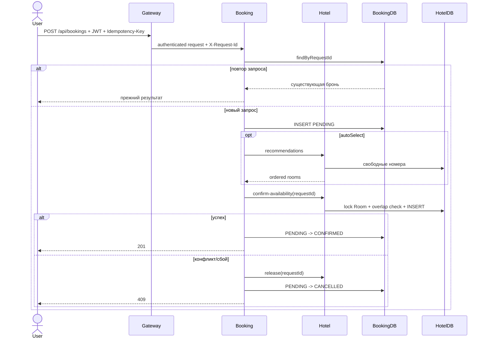

# Архитектура

## Цели

- независимое владение данными каждым бизнес-сервисом;
- единая внешняя точка входа;
- идемпотентное бронирование без распределённой транзакции;
- воспроизводимый локальный и контейнерный запуск;
- контролируемая деградация при сбоях зависимостей.

## Компоненты

| Компонент | Ответственность | Данные |
|---|---|---|
| API Gateway | маршрутизация, JWT, correlation ID | нет |
| Eureka | обнаружение сервисов | временный registry |
| Booking Service | пользователи, брони, оркестрация Saga | `users`, `bookings` |
| Hotel Service | каталог, доступность, блокировки | `hotels`, `rooms`, `room_reservations` |

Сервисы не читают таблицы друг друга. Межсервисное взаимодействие проходит только
через внутренний HTTP-контракт.

## Слои бизнес-сервисов

Контроллеры отвечают за HTTP-контракт, сервисы — за сценарии и транзакции,
репозитории — за хранение, Feign-фасад — за отказоустойчивые удалённые вызовы.

## Последовательность бронирования

Слот — полуинтервал `[startDate, endDate)`. Confirm/release идемпотентны благодаря
уникальному `requestId`. Retry не применяется к бизнес-конфликтам `409`.

## Развёртывание и профили

Базовый `docker-compose.yml` публикует только Gateway. Dev-overlay открывает Eureka,
сервисы и БД для Swagger и отладки. Приложения работают непривилегированным
пользователем, имеют health checks и стартуют после готовности зависимостей.

| Профиль | База | Схема | Назначение |
|---|---|---|---|
| default | H2 | Hibernate `create-drop` | локальная разработка |
| test | отдельная H2 | Hibernate `create-drop` | автотесты |
| docker | PostgreSQL 17 | Flyway + Hibernate `validate` | VM/контейнеры |

## Отказоустойчивость

- Feign timeout 2 секунды, retry с backoff и circuit breaker;
- `X-Request-Id`, `bookingId` и `requestId` попадают в MDC;
- Actuator предоставляет liveness/readiness и метрики;
- PostgreSQL volumes сохраняют состояние при пересоздании контейнеров.

Следующий production-шаг — persistent outbox/inbox и worker повторной компенсации.
